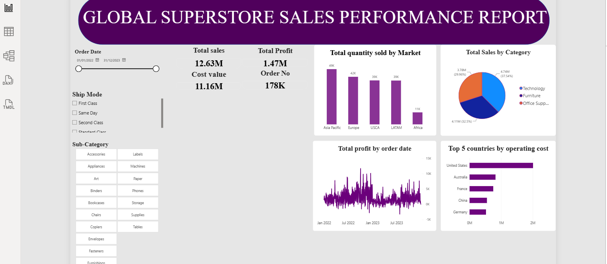

# Data Analytics Project Portfolio
# Project 1

**Title:** NHS Interactive Dashboard 

**Tools Used:** Microsoft Excel (Pivot Table, Pivot Chart, Slicers, Timelines, Power Query Editor)

**Project Description:** This project focuses on analysing healthcare data using Microsoft Excel to develop an interactive NHS-style analytics dashboard. The aim is to transform patient records into meaningful insights that support understanding of patient demographics, medical conditions, admission patterns, laboratory test results, and healthcare billing costs. The dashboard is designed to help users explore healthcare trends, compare categories, and identify patterns that could inform service planning, resource allocation, and financial monitoring

**Key findings:** Patient population: The dataset includes 4,999 patients, with an average age of approximately 52 years. Patients range from 18 to 85 years old.

Gender distribution: The dataset is almost evenly split between male patients (2,521) and female patients (2,478).

Medical conditions: Cancer is the most frequently recorded condition, with 861 patients, followed by diabetes (841) and asthma (837). Obesity has the lowest count, at 809.

Admission patterns: Elective admissions are the largest category, with 1,686 cases, followed by emergency admissions (1,664) and urgent admissions (1,649). The distribution is relatively balanced.

Test results: Abnormal results account for 1,704 records, inconclusive results for 1,659, and normal results for 1,636. Abnormal results are the largest category, highlighting an area for further clinical investigation.

Healthcare costs: Total recorded billing amounts are approximately 128.16 million in the dataset's unspecified currency units, with an average bill of approximately 25,636 per patient.

Insurance providers: Medicare has the highest total billing amount, at approximately 26.32 million, while Aetna has the lowest, at approximately 24.54 million.

Length of stay: The average interval between admission and discharge dates is approximately 15.4 days. This is a descriptive measure and does not establish whether the stay was clinically appropriate.

**Dashboard Overview:** The analysis shows a diverse patient population, a relatively balanced distribution of admission types, and broadly similar numbers across the six medical conditions. Abnormal test results form the largest test-result category, while Medicare records the highest total billing expenditure among the insurance providers.

These findings demonstrate how interactive healthcare dashboards can support the monitoring of patient characteristics, admission activity, diagnostic outcomes, and financial performance.

# Project 2

**Title:** GLOBAL SUPER SALES POWERBI DASHOARD

**Tools Used:** Microsoft Powerbi (Microsoft Excel, Pivot Chart, Slicers, Timelines, Power Query Editor)

**Project Description:** This project involves analysing the Global Superstore dataset using Microsoft Power BI to evaluate sales performance, profitability, operating costs, product demand and geographical performance. The dashboard presents key business metrics through interactive visualisations, enabling users to understand business performance, identify trends and make informed, data-driven decisions. Users can explore the data by filtering order dates, shipping modes and product sub-categories to gain deeper insights into different areas of the business.

**Key findings:** This project analysis the overall   performances of the business. It provides the activities of total sales, profit, operating costs and quantities sold, assisting to making a reasonable decision that will boast the business profitability. The profit trend visualisation shows how profitability changes over time, supporting the identification of periods of stronger or weaker financial performance. The sales-by-category chart enables comparisons between product categories and helps identify their contributions to overall revenue. The quantity-by-market visualisation provides insight into product demand across different markets, while the operating-cost-by-country chart supports the assessment of costs across geographical locations. The interactive filters also allow users to investigate specific periods, shipping methods and product sub-categories, making it easier to explore performance patterns and potential areas for improvement.

**Dashboard Overview:** This dashboard serves as a crucial tool for the  company’s management team, providing clear, actionable insights that drive informed decision-making and strategic planning.

